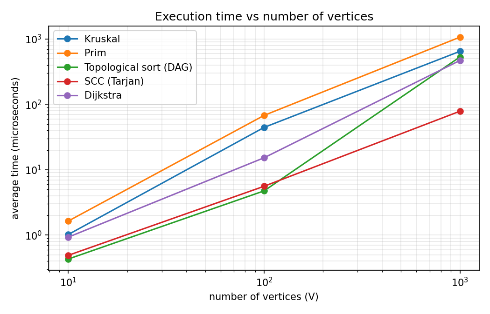
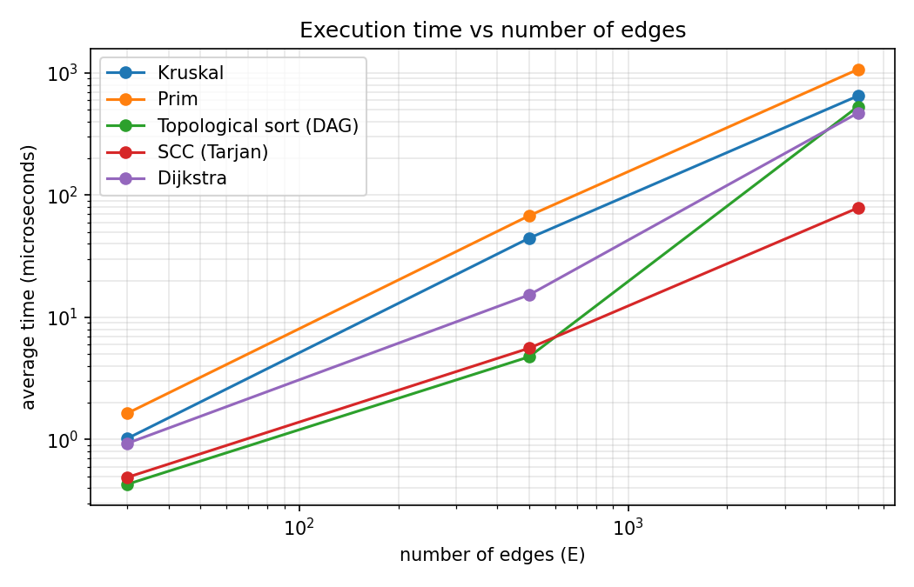
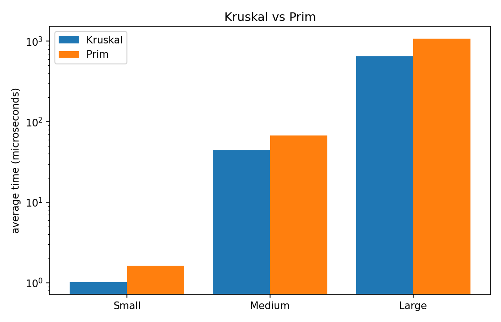
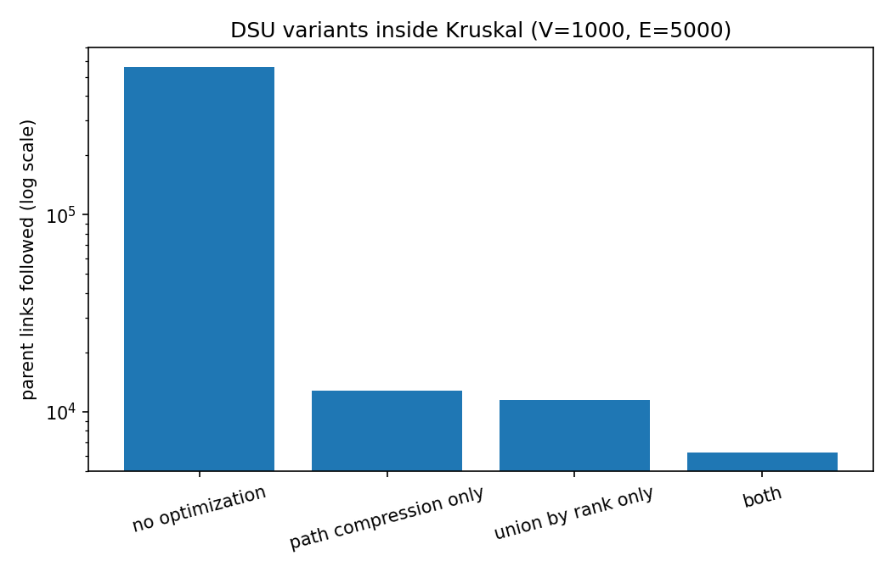

# Assignment 3 — Smart City Infrastructure and Route Planning

Java implementation of graph algorithms for a smart city: connecting districts at minimum cost (MST),
checking connectivity (topological order, SCC) and finding shortest routes (Dijkstra), together with
an experimental and complexity analysis.

## 1. Overview

A city is a graph. **Vertices** are districts (numbered `0..V-1`), **edges** are roads or infrastructure
links and the **weight** is a construction cost or a distance (integer, 1..100 in the generated graphs).

* Undirected graphs are used for the MST (Task 1) and Dijkstra (Task 3).
* Directed graphs are used for topological ordering and SCC (Task 2) — one-way roads or dependencies between services.

**Graph representation.** `graph.Graph` stores an **adjacency list** (`List<List<Edge>>`) and also a plain list of all
edges (each edge once). The adjacency list is used by Prim, Dijkstra, Kahn and Tarjan, the edge list is used by Kruskal
(it needs to sort all edges). For an undirected edge the reverse edge is added to the adjacency list automatically.

### Project structure

```
assignment-3/
├── src/
│   ├── graph/          Edge, Graph, GraphGenerator
│   ├── dsu/            DSU
│   ├── mst/            Kruskal, Prim, MSTResult
│   ├── connectivity/   TopologicalSort, TopoResult, SCC
│   ├── shortestpath/   Dijkstra, DijkstraResult
│   ├── Main.java       runs the experiments, writes csv tables
│   └── Tests.java      correctness tests (no external libraries)
├── results/
│   ├── tables/         csv tables written by Main
│   ├── plots/          png plots
│   └── make_plots.py   builds the plots from the csv tables
└── README.md
```

### How to run

```
javac -d out $(find src -name "*.java")
java -cp out Tests          # 36 correctness checks
java -cp out Main           # experiments -> results/tables/*.csv
python3 results/make_plots.py   # plots -> results/plots/*.png (needs matplotlib)
```

## 2. Implementation

**DSU** (`dsu.DSU`). Arrays `parent` and `rank`. `find` follows parents to the root and then, in a second pass,
points every vertex on the path directly to the root (**path compression**). `union` attaches the tree with the smaller
rank under the bigger one (**union by rank**). Both optimizations can be switched off with a constructor flag, so the
experiment can compare the four variants. The class counts `find` calls, `union` calls and parent links followed.

**Kruskal** (`mst.Kruskal`). Copies and sorts the edge list by weight (comparisons are counted inside the comparator),
then goes through the edges and uses `union` to skip edges that would close a cycle. It stops when `V-1` edges are taken.
If at the end the DSU has more than one component the graph is **not connected** and the result is a minimum spanning forest.

**Prim** (`mst.Prim`). Lazy version with `java.util.PriorityQueue` of edges. It starts from vertex 0, adds all its edges to the
queue, takes the cheapest edge and, if its end is not visited yet, adds it to the tree. To handle disconnected graphs it
restarts from every unvisited vertex; the number of restarts is the number of components. So Kruskal and Prim give the same
forest weight even for disconnected graphs.

**Topological ordering** (`connectivity.TopologicalSort`). Kahn's algorithm (in-degrees + queue). If after the algorithm
fewer than `V` vertices were output, the graph has a cycle, so `hasCycle = true` and no order is returned.

**SCC** (`connectivity.SCC`). Tarjan's algorithm (`index`, `low`, stack). Each vertex is put into exactly one component.
The DFS is recursive; for `V = 1000` this is fine, for very big graphs the recursion depth could be a problem.

**Dijkstra** (`shortestpath.Dijkstra`). Binary heap (`PriorityQueue<long[]>`) with lazy deletion: old queue entries are skipped
when popped. `dist[v] = Long.MAX_VALUE` marks an unreachable vertex and `pathTo(v)` rebuilds the path from the `prev` array
(empty list if unreachable). If an edge with negative weight is found, an exception is thrown.

**Why Dijkstra does not work with negative edges.** When Dijkstra takes vertex `v` out of the queue it decides that `dist[v]` is final,
because any other path must first go through vertices that are at least as far, and edges can only make the distance bigger.
A negative edge breaks this. Example: `0→1` (2), `0→2` (3), `2→1` (−2). Dijkstra finishes vertex 1 with distance 2 before it
sees vertex 2, but the real shortest path is `0→2→1` with length 1. Allowing re-visits of vertices does not fix it in general
(negative cycles, and the running time becomes bad), so for negative weights Bellman-Ford should be used.

## 3. Complexity Analysis

Assumptions: graph stored as adjacency list, `V` vertices, `E` edges, binary heap (`PriorityQueue`), `α` is the inverse
Ackermann function (practically ≤ 4).

| Algorithm | Time | Space | Notes |
|---|---|---|---|
| DSU `find` / `union` (path compression + rank) | O(α(V)) amortized per operation | O(V) | m operations on n elements: O(m·α(n)) |
| DSU without optimizations | O(V) worst case per operation | O(V) | trees can become long chains |
| Kruskal | O(E log E) = O(E log V) | O(V + E) | sorting dominates; the DSU part is O(E·α(V)) |
| Prim (lazy, binary heap) | O(E log E) = O(E log V) | O(V + E) | heap can hold up to 2E entries |
| Topological sort (Kahn) | O(V + E) | O(V) | every vertex and edge handled once |
| SCC (Tarjan) | O(V + E) | O(V) | plus recursion stack up to O(V) |
| Dijkstra (binary heap, lazy deletion) | O((V + E) log V) | O(V + E) | needs non-negative weights |

**How V and E affect performance.**

* *DSU:* the cost depends on the number of operations (about 2E finds in Kruskal), not on V directly. Without optimization a
  single find can walk through O(V) vertices; with them the tree is almost flat.
* *Kruskal:* grows with E because of sorting (E log E). V only matters for the DSU size and the stop condition (V−1 edges).
* *Prim:* grows with E log V, because each edge can be pushed to the heap. In a dense graph Prim with an array would be O(V²), which
  is better, but here we use a heap.
* *Kahn and Tarjan:* linear in V + E. Doubling the graph doubles the work.
* *Dijkstra:* each edge can cause one heap insertion (log V), so E log V; in a sparse graph (E ≈ V) it is close to V log V.

## 4. Experimental Setup

* **Graph sizes:** Small (V=10, E=30), Medium (V=100, E=500), Large (V=1000, E=5000).
* **Reproducibility:** `java.util.Random` with the fixed seed `42` for every graph. Same seed gives the same graph every run.
* **Weights:** random integers 1..100. No duplicate edges and no self loops.
* **Connected undirected graph (MST, Dijkstra):** first a random spanning tree (vertex `i` is connected to a random vertex `j < i`),
  so the graph is always connected, then random extra edges are added until `E` edges exist.
* **DAG (topological sort):** random pairs `(a, b)` are turned into an edge from the smaller to the bigger number, so there
  are no cycles by construction.
* **Directed graph with cycles (topological sort, SCC):** random pairs in any direction, with no duplicates. It contains cycles
  (the topological sort reports a cycle for all three sizes) and has a big strongly connected part.
* **Measurement:** `System.nanoTime()` around one call of the algorithm; each experiment is repeated **5 times** and the
  average is reported (µs). Graph generation is not included in the time. Before measuring, the JVM is warmed up (untimed runs)
  so the JIT compiler does not distort the first measurements.
* **Operation counters:** comparisons (sorting comparator for Kruskal, heap comparator for Prim), edge examinations,
  DSU `find`/`union` calls and parent links followed, heap insertions/removals, edge relaxations for Dijkstra.
* The times are from one run of `Main` on one machine. They change a little from run to run (and between computers),
  the operation counts are exactly the same every time.

## 5. Results

### 5.1 Kruskal vs Prim

| Graph | V | E | Algorithm | Avg time (µs) | MST weight | Comparisons | Edge exam. | DSU finds | DSU unions | Heap ops |
|---|---|---|---|---|---|---|---|---|---|---|
| Small | 10 | 30 | Kruskal | 1.02 | 129 | 107 | 14 | 28 | 14 | 0 |
| Small | 10 | 30 | Prim | 1.64 | 129 | 203 | 60 | 0 | 0 | 60 |
| Medium | 100 | 500 | Kruskal | 44.48 | 1170 | 3827 | 164 | 328 | 164 | 0 |
| Medium | 100 | 500 | Prim | 67.92 | 1170 | 7697 | 1000 | 0 | 0 | 1000 |
| Large | 1000 | 5000 | Kruskal | 649.55 | 13123 | 50369 | 3356 | 6712 | 3356 | 0 |
| Large | 1000 | 5000 | Prim | 1070.50 | 13123 | 110958 | 10000 | 0 | 0 | 10000 |

Both algorithms return the same total weight on all three graphs (129, 1170, 13123).

### 5.2 DSU optimizations (inside Kruskal)

| Graph | V | E | DSU variant | Avg time (µs) | find calls | union calls | parent links followed |
|---|---|---|---|---|---|---|---|
| Small | 10 | 30 | no optimization | 0.88 | 28 | 14 | 18 |
| Small | 10 | 30 | path compression only | 0.88 | 28 | 14 | 17 |
| Small | 10 | 30 | union by rank only | 0.86 | 28 | 14 | 17 |
| Small | 10 | 30 | both | 0.90 | 28 | 14 | 15 |
| Medium | 100 | 500 | no optimization | 57.42 | 328 | 164 | 1977 |
| Medium | 100 | 500 | path compression only | 34.56 | 328 | 164 | 416 |
| Medium | 100 | 500 | union by rank only | 38.54 | 328 | 164 | 314 |
| Medium | 100 | 500 | both | 28.35 | 328 | 164 | 248 |
| Large | 1000 | 5000 | no optimization | 1729.89 | 6712 | 3356 | 561684 |
| Large | 1000 | 5000 | path compression only | 684.57 | 6712 | 3356 | 12838 |
| Large | 1000 | 5000 | union by rank only | 717.02 | 6712 | 3356 | 11492 |
| Large | 1000 | 5000 | both | 881.76 | 6712 | 3356 | 6238 |

### 5.3 Topological ordering (DAG and graph with cycles)

| Graph | V | E | Input | Avg time (µs) | Cycle found | Order size | Edge exam. |
|---|---|---|---|---|---|---|---|
| Small | 10 | 30 | DAG | 0.43 | false | 10 | 60 |
| Small | 10 | 30 | with cycles | 0.16 | true | 0 | 30 |
| Medium | 100 | 500 | DAG | 4.75 | false | 100 | 1000 |
| Medium | 100 | 500 | with cycles | 0.95 | true | 0 | 500 |
| Large | 1000 | 5000 | DAG | 531.82 | false | 1000 | 10000 |
| Large | 1000 | 5000 | with cycles | 8.98 | true | 0 | 5054 |

### 5.4 Strongly connected components

| Graph | V | E | Avg time (µs) | # SCCs | Largest SCC | Edge exam. |
|---|---|---|---|---|---|---|
| Small | 10 | 30 | 0.49 | 1 | 10 | 30 |
| Medium | 100 | 500 | 5.59 | 1 | 100 | 500 |
| Large | 1000 | 5000 | 78.67 | 18 | 983 | 5000 |

### 5.5 Dijkstra (source = vertex 0)

| Graph | V | E | Avg time (µs) | Reachable | Edges examined | Successful relaxations | Heap ops |
|---|---|---|---|---|---|---|---|
| Small | 10 | 30 | 0.93 | 10 | 60 | 17 | 36 |
| Medium | 100 | 500 | 15.26 | 100 | 1000 | 199 | 400 |
| Large | 1000 | 5000 | 470.75 | 1000 | 10000 | 1986 | 3974 |

### 5.6 Plots





Note: in the required configurations V and E grow together (E = 3V, 5V, 5V), so the two plots have the same shape,
with the edges plot shifted to the right. Both axes are logarithmic.





## 6. Comparison and Discussion

**Kruskal vs Prim.** Both give the same MST weight. In the Large graph Kruskal examined only 3356 of the 5000 edges (it stops after
V−1 = 999 edges are accepted) and did about 50 thousand comparisons while sorting, which is close to the theory
`E·log₂E ≈ 5000·12.3 ≈ 61 thousand`. Lazy Prim looked at every adjacency entry (2E = 10000) and did 10000 heap operations with
about 111 thousand comparisons, more than twice as many as Kruskal. In our runs Kruskal was faster than Prim on all three sizes.
This matches the counters. Both are O(E log V), so the difference is only a constant factor: Prim pushes each edge into the heap from
both ends, while Kruskal sorts every edge once and then uses cheap DSU operations. For a very dense graph the result may be different.

**DSU.** On the Large graph the number of parent links followed was **561,684** without optimizations, **12,838** with path
compression only, **11,492** with union by rank only and **6,238** with both, about 90 times fewer than the plain version.
Without union by rank, `union` can hang a big tree under a small one, so trees become long chains and one `find` walks
about 84 links on average (561684 / 6712 finds). Union by rank keeps the height O(log V). Path compression makes every
later `find` on the same vertices almost O(1), because it points them straight to the root. Together they give
the amortized O(α(V)) bound. In time, the unoptimized DSU was about 2 times slower on the Large graph. The three optimized variants
are close to each other in time (the differences are within the noise of a few hundred µs, sorting is part of the measured time too),
so the parent-link counter is the more reliable evidence. On the Small graph there is almost no difference because the trees are tiny.

**SCC.** Time grew from about 0.5 µs (V+E = 40) to about 5 µs (V+E = 600) to about 80 µs (V+E = 6000), roughly proportional to V+E,
as expected for O(V+E). The number of edge examinations was exactly E every time (each edge is looked at once). In the Small and Medium
graphs the whole graph is one strongly connected component. In the Large graph (average out-degree 5) there is one giant component with 983 vertices
and 17 other vertices which are single-vertex components, 18 components in total. Every vertex was in exactly one component in all tests.

**Topological ordering.** On DAGs the algorithm outputs all V vertices and examines 2E edges (E to count in-degrees and E while
removing vertices). On graphs with cycles it stops early: the queue becomes empty after a few vertices (no order is returned, a cycle is reported),
so it examines only E + a few edges (5054 on the Large graph) and is much faster. The measured time for the large DAG is higher than the operation count suggests
(compared with SCC, which does half as many edge examinations); this is probably a constant-factor effect (boxing of `Integer` in the queue and result list, two passes
over the data), we did not profile it. The growth is still linear in the number of operations.

**Dijkstra.** All vertices were reachable (the graph is connected). The edges examined were exactly 2E (each undirected edge is seen from both ends), the heap
operations were 400 and 3974 for V=100 and V=1000, much smaller than 2E because only 199 / 1986 relaxations were successful (the rest do not improve the distance).
The time grows faster than linearly with size, which is in line with O(E log V) (and the cost of allocating a `long[]` for every heap entry). Dijkstra and Prim are similar algorithms (both grow a set from the source with a
heap), so their times in the table are of the same order.

**Theory vs experiment.** The counters agree with the theory: `E log E` comparisons for sorting, exactly `E` or `2E` edge examinations for the linear algorithms.
The times agree with the theory only roughly. On the Small graph everything takes around 1 µs, so timer and JVM effects are bigger than the algorithm itself;
timings there should not be compared too strictly. From Medium to Large (V and E grow by 10) Kruskal, Prim and SCC became roughly 15 times slower, which is close to the
expected 10× plus a log factor. Dijkstra and the topological sort on the DAG grew more than that in our runs (about 30× and 100× or more),
more than the theory predicts, so for these two the constant factors (heap objects, boxing, memory access) clearly matter. Because of this
the operation counters, not the raw times, are the better evidence for the complexity.

## 7. Testing

All tests are in `src/Tests.java` and are run with `java -cp out Tests` (36 checks, all pass). They use no libraries.

| Area | What is tested |
|---|---|
| DSU | different sets at the start, union returns true/false, connectivity after unions, component count |
| Small graph | hand-computed MST weight (6) for both algorithms, `V-1` edges in the tree |
| Single vertex | MST weight 0 and connected (Kruskal and Prim), topological sort, SCC, Dijkstra |
| Disconnected graph | `connected = false`, 2 components, forest weight 14 for both algorithms |
| Cycles / multiple MSTs / duplicate weights | triangle with equal weights (weight 10), square with equal weights (weight 6) |
| Kruskal = Prim | same MST weight on 30 random connected graphs; Kruskal with and without DSU optimizations gives the same weight |
| Topological sort | valid order checked edge by edge on a small DAG and on 20 random DAGs; cycle detected on a 3-cycle |
| SCC | known graph with components {0,1,2}, {3,4}, {5}; a DAG has V components; on 20 random directed graphs every vertex is in exactly one component |
| Dijkstra | hand-computed distances and path; unreachable vertex has distance INF and an empty path; directed edges are respected; same distances as a simple Bellman-Ford on a random graph; negative weight is rejected |

## 8. Conclusion

* **MST:** Kruskal (with DSU) and Prim always agree on the weight. Kruskal was faster on our sparse graphs and is simple when the edges are
  already a list, and it reports connectivity for free through the DSU component count. Prim is a good choice when the graph is already an
  adjacency list or is dense (with an array or a better heap).
* **DSU:** path compression and union by rank are cheap to write and reduce the work by about two orders of magnitude on the Large
  graph; they should always be used.
* **Dependencies and one-way roads:** Kahn's topological sort is a linear way to find an order of dependent services and to detect circular dependencies.
  Tarjan's SCC finds groups of locations that can reach each other. Both are O(V+E) and fast for the sizes tested.
* **Routes:** Dijkstra with a binary heap is the right choice for shortest routes with non-negative distances. For negative weights Bellman-Ford is needed.
